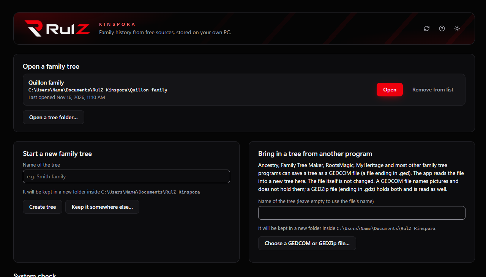
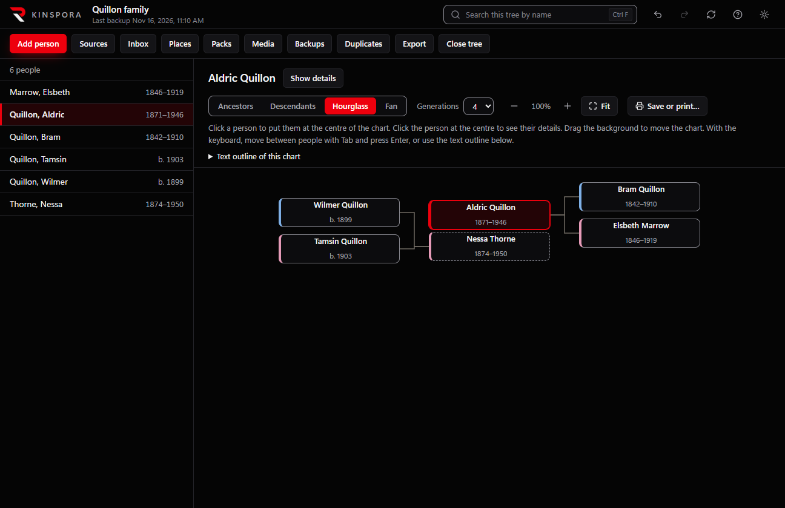

# RulZ Kinspora

A Windows desktop app for building a family tree and researching it with free
data sources. Everything is stored on your own PC.

## Install

1. Download `RulZ-Kinspora-Setup-<version>.exe` from the
   [GitHub Releases page](https://github.com/speedyrulz/rulz-kinspora/releases/latest), and from
   nowhere else. It needs Windows 10 or 11, 64-bit.
2. Run it. The installer is not signed, so Windows shows "Windows protected your PC". Choose
   **More info**, then **Run anyway**. It appears because the file is new and unsigned, not because
   it is harmful.
3. The app checks GitHub for a newer release when it starts, and offers "Update now" or "Not now".
   "Not now" hides that version at later launches until a newer one is out or you check by hand.
   The updates button in the top bar opens the "App updates" window, where you can switch the
   check off or press "Check now". "Update now" downloads the installer from GitHub
   (github.com, then a githubusercontent.com download host).
   Uninstalling (Windows Settings, Apps) keeps your trees, settings and packs.

Help that works offline is in the app (the question-mark button). What the app stores, which internet
addresses it can ask and what it sends is in [docs/PRIVACY.md](docs/PRIVACY.md). What each release
changed, and its known limits, is in [docs/RELEASE-NOTES.md](docs/RELEASE-NOTES.md).





Status: **Phase 1 is built with one check open, and Phase 2 has started.** You
can create a family tree, add and edit people with their names, events,
parents, partners and children, search the tree by name, and undo or redo every
change. The app backs the tree up when it closes. You can bring in a tree from
Ancestry or another program as a GEDCOM file, and write a tree out as one. You
can draw four kinds of chart, ask how two people are related, and find and
merge people who were entered twice. You can record the sources a tree rests
on and say which names and events each one supports. You can attach pictures
and documents to people, events, families, citations and sources, and look at
a picture at full size. The pictures and documents a GEDCOM file names are read
and written, and a GEDZip file takes the files themselves along. A person, an
event and a source can each carry a note. One real export from Ancestry has
been tried and comes back out line for line. The app offers places while you
type, and can link each place of a tree to where it lies on the map, from a
list of the world's places that it downloads when you ask. A person's page
tells their life as a timeline and marks its places on a map. Phase 2 is
complete with that. Phase 3 is complete too: the app can search WikiTree, the
records of Dutch and Belgian archives at Open Archives, and Wikidata for a
person of your tree, and attach a result to the person as a source with one
click. It searches the newspapers of the Library of Congress, the books of
the Internet Archive and the catalog of the US National Archives for words,
such as the person's name; the National Archives need a free key of your own. It opens a search at
Find a Grave or FamilySearch in your browser, and a page you find there becomes
a source when you paste its address. Phase 4 is complete as well: each result that is a
person or a record of a person says how well it fits the person of your tree, and
can be set beside that person, to take over the dates and places you tick. A
result can be kept in an inbox to look at later, or turned down for a person.
And one press searches for a person and their direct ancestors, after listing
who is asked for. See
[docs/PLAN.md](docs/PLAN.md) for the full plan and
[docs/ACCESS.md](docs/ACCESS.md) for the API keys and applications that only
the project owner can request.

A tree is a folder holding `tree.db`, a `backups` folder and, once the tree
holds a picture or document, a `media` folder. By default it is made in
`Documents\RulZ Kinspora`. To move a tree, move its folder and open it again
with "Open a tree folder". To keep a tree safe, copy the whole folder: the
backups hold the tree's data, not its pictures and documents.

GEDCOM is the file format family tree programs use to pass a tree to one
another. The app reads versions 5.5.1 and 7.0 and writes both.

- **Import** always makes a new tree; the file itself is not changed. Details
  the app has no screens for yet (a second note on one thing, other programs'
  own tags) are kept
  exactly as written and go back into an export.
- **Export** in the version the file came in gives the same file again, line
  for line, apart from its header. After edits, only the edited lines differ.
- **Living people are left out of an export** unless you choose to include
  everyone.
- The import has been tested on files written the way Ancestry writes its
  exports, including one with 10,000 people, which takes about 3 seconds. One
  real export from Ancestry, of 162 people, has been tried; no export from
  another program has.

Charts, relationships and duplicates:

- **Charts.** "Chart" on a person's page draws their ancestors, their
  descendants, both (an hourglass), or a fan of ancestors. Click a person to
  put them at the centre.
- **Relationships.** "Relationship" on a person's page says how anyone else in
  the tree is related to them, for example "second cousin once removed" or
  "father-in-law", and lists the people in between.
- **Duplicates.** "Duplicates" lists the people most likely to be in the tree
  twice, with the reasons. Nothing is merged until you compare two records
  and say so. A merge keeps everything both records had and is one undo step.
- The duplicate scores were set by hand and have not been checked against a
  real tree, so treat the list as suggestions.

Sources:

- **A source** is where information comes from: a census, a register, a
  certificate, a book. "Sources" on the tree screen lists them all.
- **A citation** is one place in a source, with what it says there. "Sources"
  beside a name or an event on a person's page lists the citations that fact
  rests on, and adds, edits and removes them.
- **One citation can support several facts.** One census entry gives a name, a
  year of birth and a residence; it is entered once and edited once.
- **Sources in a GEDCOM file** are read into these screens and written back.
  A tree imported by an earlier build is upgraded when it is opened, after a
  copy of it is put in its backups folder.
- **A citation can carry the web address of the record** and the day you
  looked at it. Both are read from and written to GEDCOM files; an address
  Ancestry wrote for a record is shown and opens in your browser.
- Where a source is kept (an archive, a website) has no field of its own yet.

Pictures and documents:

- **Adding a file copies it into the tree.** The copy goes into the tree's
  `media` folder; the file you chose stays where it was. The same file added
  twice is kept once.
- **A file can be attached** to a person, a family, an event, a citation or a
  source, and to several of them. A scan of a register page belongs with the
  citation of that page.
- **The viewer** shows a picture fitted to the window and zooms to its real
  size and beyond, with the buttons, the mouse wheel or the keyboard. Drag to
  move.
- **"Media"** on the tree screen lists every file in the tree, including those
  attached to nothing.
- **Other files** (PDF, TIFF, text, sound, film) are kept in the tree and
  opened in the program Windows uses for them.
- **Deleting a file from the tree leaves its copy on the disk,** so that Undo
  can bring it back. The app does not free that space yet.
- **One file is one entry,** however often it is added in the app. Only an
  imported file that lists one picture twice gives two entries.

Pictures and documents in GEDCOM files:

- **A GEDCOM file names files; it does not hold them.** After an import the
  tree knows each picture by its title and by what it belongs to, and shows
  "Not in the tree" until it has the file.
- **"Find the files in a folder"** under "Media" looks in a folder you choose,
  and the folders inside it, for the files by name, and takes a copy of each
  one it finds. "Choose the file" in the viewer does the same for one file.
- **The app opens no path a GEDCOM file gives.** It shows the path or web
  address, and takes a file only from a place you point at.
- **A GEDZip file** (`.gdz`) is a zip file with a GEDCOM file and the files it
  names. The import reads one and takes its pictures into the tree. The export
  dialog writes one with every file the tree holds.
- **A GEDCOM file written on its own** names every picture and document: those
  that were imported as they were written, those added in the app as new
  records.
- **Pictures that belong only to people an export leaves out are left out
  too,** and the export says how many.
- Archives over 4 GB are not read or written. Nothing is downloaded from a web
  address. No GEDZip file from another program has been tried.

Places:

- **The place of an event is the text you type,** and the app never changes it.
- **Places are offered while you type:** first the places your tree already
  has, then places from all over the world once the place list is downloaded.
- **The place list is downloaded when you ask,** with "Download the place
  list" under "Places" on the tree screen: about 100 MB, from
  [GeoNames](https://www.geonames.org/), licensed
  [CC BY 4.0](https://creativecommons.org/licenses/by/4.0/). It becomes a file
  of about 76 MB in the app's own folder, holding 550,000 places: every town,
  village, township and county of the United States, the Netherlands, the
  United Kingdom, Ireland, Australia and New Zealand, and the towns of 500
  people and more elsewhere. It can be removed again.
- **This download sends nothing about you or your tree.** Apart from it, the
  app asks the internet only when you search for records (see below).
- **Linking a place** says where it lies. "Places" lists every place of the
  tree, offers the entry of the place list that fits each best, and links it
  with one press; every event at that place then shares the link. A place
  picked from the list while typing is linked at once.
- **A tree keeps the coordinates of its linked places,** so it does not need
  the place list on another PC.
- Links are not written to a GEDCOM file, and places are linked one at a
  time.

Timeline and map:

- **"Timeline and map" on a person's page** tells the life in order: the
  person's own events, their marriages, and the births and deaths close to
  them, with how old the person was at each. Events without a date are listed
  apart.
- **The map marks every place that is linked to the place list,** with the
  number that stands beside it in the timeline. Places that lie far apart can
  be looked at one area at a time.
- **The map is drawn from outlines the app ships with:** countries, and the
  states, provinces and counties of seven countries, from
  [Natural Earth](https://www.naturalearthdata.com/) (public domain). It shows
  borders and coasts, no roads or towns, and asks nothing of the internet.
- A place that is not linked is named under the map; "Places" links it.

Searching for records:

- **"Search records" on a person's page** looks for the person at three
  services. The form starts with their name and their years of birth and
  death; you can change or empty each before you search.
  - [WikiTree](https://www.wikitree.com/), a shared family tree, is sent the
    four fields.
  - [Open Archives](https://www.openarchieven.nl/en/) indexes the records of
    Dutch and Belgian archives. It is sent the name, and the years as a span
    from two years before the birth to two years after the death. A result is
    a record that names the person in some role: the child of a birth record,
    the bride or a witness of a marriage.
  - [Wikidata](https://www.wikidata.org/) has entries for people of some note
    only. It is sent the name, not the years.
- **How well a result fits.** Each result that is a person, or a record that
  names one, carries a label: "Fits well", "May fit", "Little to go by", "Some
  details conflict" or "Does not fit", with what agrees and what speaks
  against it. The app
  holds the result against the person in your tree: every name you recorded,
  the years of birth and death, the places, the sex. It does this on your PC;
  nothing is sent for it. A label helps you read a long list and proves
  nothing: two people of one name, born in one year in one town, both "fit
  well". Newspapers, books and archive descriptions get no label, because
  they are found by their words.
- **Compare, and take over.** "Compare" on a result sets it beside the person:
  for the person's birth, baptism, death and burial, the date and the place
  your tree has, what the record says, and how the two stand ("The record is
  more exact", "Your tree is more exact", "They differ", "Only the record has
  it"). You tick what to take over; nothing is ticked for you. One press
  writes it and cites the record as the source of the person and of each
  event you changed, and one Undo takes all of it back.
  - A date or place that says less than your tree's is not offered: a year
    where you have the day, a shorter place where yours begins the same way.
  - A baptism is not written as a birth, nor a burial as a death, and nothing
    is taken from a record in which the person is a bride, a parent or a
    witness. Names and the sex are shown for reading and are not taken over.
  - The app does not know whether a record is of your person, and it compares
    places by their words: it cannot tell "Ashford, VT" from another Ashford,
    so it says only that the two begin alike.
  - Nothing is sent to the internet for any of this.
- **Keep for later, or turn down.** Each result has two more buttons.
  - "Keep for later" puts the result into the **Inbox**, which a button in the
    bar at the top opens. It is still there after you close the tree or the
    app. From the inbox you can compare it with the person, attach it as a
    source, turn it down or remove it.
  - "Not this person" turns the result down for the person you searched for.
    Later searches for that person leave it out and say how many were left
    out; "Show" brings them back into view, and "Allow again" takes the
    turning-down back. For another person the same record is shown as before.
  - Both are saved in your tree's file, so they are in its backups and go
    where its folder goes. Each is one step that Undo takes back. Nothing is
    sent to the internet for either, and nothing of it is written to a GEDCOM
    file.
  - A kept result is the record as its source had it on the day you kept it;
    the inbox says which day. The source may say something else by now.
  - Of a result of the US National Archives only the identifier and the
    address are kept, because their terms do not allow keeping more.
- **Search for ancestors.** "Search for ancestors" on a person's page asks
  for that person and their direct ancestors with one press.
  - First it lists who would be asked for, the nearest first, with the name
    and the years that would be sent for each, and who is left out: anyone
    who may be living, anyone without a given name or a surname, anyone
    without a year of birth or death. You choose how far back it goes, from
    the parents to five generations, and it says how many requests the press
    sends at most. Nothing is sent before you press "Start".
  - It asks [WikiTree](https://www.wikitree.com/) and
    [Open Archives](https://www.openarchieven.nl/) only, and only those you
    tick. WikiTree is ticked to begin with.
  - Each person is asked for once at each service, for the first 20 results,
    with at least a second between two requests to one service. Nothing is
    asked a second time. A service that says it is asked too often, or does
    not answer twice in a row, is left alone for the rest of that search.
  - "Stop" ends it, and so does closing its window, closing the tree or
    quitting the app. It never starts by itself.
  - The results stand person by person, with the same labels and buttons as
    after a search for one person. Nothing is written into your tree until
    you attach or keep a result, one at a time.
  - If you edit a person while the search runs, nothing is sent for them, and
    the window says so.
- **What is sent** is what the form or the list shows, when you press "Search"
  or "Start". Nothing else of your tree, nothing while you type, nothing in
  the background. The app says before the first search which service is sent
  what, and asks you to agree; it asks again when there is more to say.
- **Newspapers and books** have a form of their own, for words. It starts with
  the person's name as a phrase, printed between the year of their birth and
  the year after their death, and you can add a state.
  [Chronicling America](https://www.loc.gov/collections/chronicling-america/)
  at the Library of Congress is searched in the text of its newspaper pages;
  it can take a minute and more to answer, and the app waits up to 90 seconds.
  The [Internet Archive](https://archive.org/) is searched in the titles,
  authors and descriptions of its books, not inside them, and is sent the
  words only. The form says which service is sent what.
- **The catalog of the [US National Archives](https://catalog.archives.gov/)**
  is searched in the descriptions of what the Archives hold: military,
  immigration and naturalization records among them. It needs a key of your
  own, which the Archives give out for free by email
  ([how to ask](https://www.archives.gov/research/catalog/help/api)).
  - You type the key into the search window once. Windows encrypts it for
    your account, the app keeps only that, and it never shows the key again.
    On another Windows account or another PC you enter it again.
  - The key goes to the Archives with every search, and tells them whose
    search it is. It goes nowhere else.
  - A key allows 10,000 searches a month. The app counts its own and stops at
    9,000; every search and every "More results" is one. The window shows the
    count.
  - The Archives ask that nothing their service returns is stored. So the app
    keeps no answer, and a description you attach is cited by its identifier
    and its address alone; you can add its title to the citation yourself.
  - This product uses the National Archives Catalog API but is not endorsed
    or certified by the National Archives and Records Administration.
- **A result of these is found by its words alone.** Whether a newspaper page
  or a book is about your person is for you to read. A result does not say
  where on the page the words stand.
- **Living people:** the app does not search for a person who may be living,
  and shows no profiles of living people or private profiles. An archive
  record is shown only when it is the record of the person's own death or its
  event lies more than 110 years back, and an entry of Wikidata only when it
  gives a death or a birth more than 110 years back. The window says how many results it left
  out.
- **A service that asks to be left alone is left alone,** also after you close
  and reopen the app. The Library of Congress shuts a program out for an hour
  when it is asked too often.
- **Results** show a name, the birth and the death, and a link that opens the
  profile in your browser. They are not kept, and nothing is added to your
  tree unless you attach one.
- **"Attach as a source"** on a result cites it for the person: the source is
  "WikiTree", and the citation holds the name and id of the profile, its birth
  and death as WikiTree gives them, its address and today's date. It is one
  step for Undo. A tree has one source per site, however many records of it
  are cited.
- **Other sites.** The app never asks Find a Grave or FamilySearch anything
  itself; their terms do not allow it. A button opens a search for the same
  four fields at the site, in your own browser. The fields are part of the
  address that is opened, so the site and your browser's history hold them.
  The app does this for no person who may be living.
- **"Cite a page you found there"** makes a source of a page from your
  browser: you paste its address, and the app keeps the address and the day.
  It does not fetch the page.

An optional AI assistant is being built (Phase 4b). Claude is to propose record
matches for you to confirm, through your own Claude app or your own API key. It
is off until you turn it on. Claude Desktop and Claude Code on the same PC can
be connected, or the app can call Anthropic itself with your own API key
(built, not yet tried with a real key). **The project owner connected Claude
Desktop to a session and used it (2026-11-14). Claude Code, with the connector
its command added, called every tool against a session, and its proposals reached the inbox.** What is there
now:

- **"AI assistant" on a person's page** opens its window. Before anything else
  it says what turning it on means: what an AI could read of your tree, which
  services it could ask and within which limits, where that goes, and what is
  kept.
- **A session** is the time during which an AI app you connect may look for
  records: for one person and up to three generations of their ancestors, at
  the services you tick, with at most 10 questions to each. You start it, a
  line above the tree says so while it is under way, and you can stop it at
  any time. It also ends after 15 minutes without a call, after two hours at
  the latest, and when the tree or the app closes.
- **Connecting an AI app** is in the same window, under "Connect an AI app".
  For Claude Desktop the app hands out a connector file that you drag into
  the window of Claude Desktop once (or choose there under Settings,
  Extensions, Advanced settings, "Install Extension").
  For Claude Code it shows a command to copy, which needs Node.js 18 or later
  on the PC. The AI app can reach the app only while a session is under way:
  the app then listens on a connection of this PC that is protected by a key
  made for that session. Another program that runs under your Windows account
  could read that key. The window shows which program is connected.
- **With your own Anthropic API key** you pick that route when starting a
  session, paste the key (kept encrypted for your Windows account, never shown
  again, removable), choose a model (Opus 5.5, Sonnet 5.5 or Haiku 5.5), an
  effort and a cap in dollars, and start a run. The app stops before a request
  could pass the cap and shows tokens and an estimated cost from its own dated
  price table; check Anthropic's Console for the bill. A request already sent
  may be billed even if you stop it. The key goes only to
  `https://api.anthropic.com`.
- **What an AI proposes stands in the inbox,** in a list of its own: the
  record, the app's own label, what the AI says, and the words of the record
  each of its reasons quotes. The app shows a reason only when it found the
  quote in the record. Nothing changes in your tree until you keep or attach a
  record. A record you keep for later takes the AI's reasons along.
- **An activity log** on this PC lists every call an AI made: what it asked and
  which records it was given, never the text of a record as a service gave it.
  It does hold the words an AI asked with. You can clear it.
- **While an AI app is connected,** details of the people being researched go to the
  AI service of the app you connect, which for Claude is Anthropic. See section
  7 of the plan.
- **How well an AI judges records** is measured on made-up cases beside the
  app's own matching: `node packages/ai/scripts/measure.mjs export <folder>`
  writes a file to give the AI, and `score <folder> <answers file>` the figures.
  In a first run (Claude Sonnet 5.5, 90 records) the AI was right in 27 of the
  29 records it called a fit, the engine in 22 of 24; the AI said "may fit" to
  more records of other people. See part 4b.5 of the plan.

The [wiki](https://github.com/speedyrulz/rulz-kinspora/wiki) has the roadmap,
architecture, data sources, development guide and changelog. It is updated after
every push or merge to `main`; `.claude/hooks/wiki-reminder.cjs` reminds Claude
Code sessions to do so.

## Requirements

- Windows 10 or 11, 64-bit
- Node.js 24 or newer
- pnpm 12 (`corepack enable` picks up the version pinned in `package.json`)

## Commands

Run these from the repository root.

| Command                  | What it does                                                    |
| ------------------------ | --------------------------------------------------------------- |
| `pnpm install`           | Install dependencies                                            |
| `pnpm dev`               | Run the app with hot reload                                     |
| `pnpm test`              | Unit tests (Vitest); `pnpm test packages/db` runs one folder    |
| `pnpm typecheck`         | TypeScript check for every package                              |
| `pnpm lint`              | ESLint                                                          |
| `pnpm format`            | Format all files with Prettier                                  |
| `pnpm build`             | Production build into `apps/desktop/out`                        |
| `pnpm test:e2e`          | End-to-end tests against the production build                   |
| `pnpm package`           | Build the installer into `apps/desktop/release`                 |
| `pnpm test:e2e:packaged` | End-to-end tests against the packaged app (run `package` first) |
| `pnpm test:contract`     | Asks each searchable source one question. Needs the internet    |

## Layout

```
apps/desktop          Electron app: main process, preload script, React UI, e2e tests
packages/core         Domain logic with no Electron dependency (ids, dates, reading and writing GEDCOM, chart layout, relationship names, duplicate scoring, kinds of file)
packages/db           The tree database: schema migrations, queries, undo and redo, search, backups, GEDCOM and GEDZip import and export, chart data, relationships, duplicates and merging, sources and citations, the media folder, zip archives, data pack files
packages/connectors   One folder per data source, each with a manifest of its limits and terms
packages/ai           The rules of the optional AI assistant: what it may read of a tree and of a record, its tools, the limits on what it may ask a source, and the check of what it proposes
docs/                 Plan and access checklist
```

## Rules the code follows

- **No scraping.** A source is used only through its official API, an open bulk
  dataset, or a link opened in the user's browser. Each source's manifest in
  `packages/connectors/src/sources` records which, with its rate limits and terms.
- **The UI cannot reach Node.js.** The window runs sandboxed with context
  isolation; it talks to the main process only through the functions listed in
  `apps/desktop/src/shared/ipc.ts`.
- **What the page sends is checked.** Each of those functions validates its
  arguments in `apps/desktop/src/main/handlers.ts` before anything runs. The
  page can create a tree only in a folder the user picked, and open only a
  recent tree or a folder the user picked.
- **Every change to a tree can be undone.** Code changes a tree only through
  `Tree.transact` in `packages/db`. Database triggers record each changed row
  and reject a write made any other way. The one exception is `Tree.load`,
  which fills an empty tree from a file and is the tree's starting point.
- **An import loses nothing.** Every line of a GEDCOM file is stored, whether
  or not the app understands it, and the export puts it back. Code that
  changes a line read from a file marks it with `touch()`, so that only
  changed lines are written afresh.
- **Exports protect living people.** An export leaves out anyone who may be
  living unless the user chooses otherwise.
- **Nothing is merged automatically.** The app only suggests that two records
  may be one person. A merge moves names, events and family links to the
  record kept, drops only exact repeats, and can be undone in one step.
- **Layout and naming are plain functions.** Where a chart puts each box
  (`packages/core/src/chart.ts`) and what a relationship is called
  (`packages/core/src/kinship.ts`) are worked out from plain values, with no
  database and no screen, so they are tested as arithmetic.
- **A citation exists only while it supports something.** When the last fact
  it supports goes, the database removes the citation in the same undo step.
  A GEDCOM file has no place for a citation that supports nothing, so it would
  otherwise be lost in an export without notice.
- **A file in a tree's media folder is never changed or removed by an edit.**
  It is stored under the SHA-256 of its contents. Deleting a file from the
  tree deletes its row and leaves the copy, so undo, redo and a restored
  backup always find the file a row names.
- **The page names a file by its id, never by a path.** The user picks files
  in the system dialog. Pictures reach the page through the `rulz-media:`
  scheme, which the main process answers only from the open tree's media
  folder (`apps/desktop/src/main/mediafiles.ts`).
- **Opening a file never runs it.** Only kinds on a fixed list in
  `packages/core/src/media.ts` are handed to another program; anything else
  is shown in its folder.
- **A file comes into a tree only from where the user says.** The import
  opens no path a GEDCOM file names. Files come from the archive the GEDCOM
  file came in, by a path that stays inside it, or from a file or folder
  picked in the system dialog.
- **Nothing is written under a name from an archive.** The zip reader in
  `packages/db/src/zip.ts` hands out bytes, and the media folder files them
  under their hash. An entry larger than the limit is not unpacked, whatever
  size the archive states.
- **The text of a place is the user's.** Linking a place to the place list
  stores the entry's name and coordinates beside the text
  (`packages/db/src/places.ts`); it never rewrites the text, and it changes no
  line of an imported GEDCOM file.
- **The app asks nothing of the internet unless the user says so.** It makes
  two kinds of request: the download of the place list, and a search for
  records. Sites whose terms bar automated access are never asked: the app
  only builds a search address for them and hands it to the user's browser
  (`packages/connectors/src/links.ts`, which has no way to fetch), under the
  same notice and the same rule for living people. A search sends a name and two years, or words and the years of printing,
  after the user has agreed to a notice in its current wording, never for a person who may be living, and only through the client
  of the source (`apps/desktop/src/main/records.ts`,
  `packages/connectors/src/http.ts`): its address only, within its limits,
  without cookies. The download asks fixed addresses on
  one host (`apps/desktop/src/main/gazetteer.ts`). What arrives is not
  trusted: each file has a size limit, archives are checked, the new list is
  built beside the old one and swapped in only when complete.
- **Schema changes are migrations.** A change to the tree database is a new
  numbered file in `packages/db/src/schema`; a migration that has shipped is
  never edited. A tree is copied to its backups folder before a migration
  changes it. When a migration gives a table to something an import used to
  keep as written, the import and the migration make their rows with the same
  code, and a test compares an upgraded tree with a fresh import.
- **Development data stays separate.** `pnpm dev` stores its database in
  `%APPDATA%\RulZ Kinspora (dev)` and makes new trees in
  `Documents\RulZ Kinspora (dev)`, not in the installed app's folders. The
  end-to-end tests keep everything inside a temporary profile folder.
- **The end-to-end tests do not get in the way.** They start the app with
  `--background-window`, which opens its window beyond the edge of the screen,
  without focus and without a button on the taskbar. Set `RULZ_E2E_SHOW=1` to
  watch a run.
- **A test that measures time runs apart.** A test file with a time limit is
  listed under `TIMED` in `vitest.config.ts`. `pnpm test` runs those files
  after all the others, one at a time, so that the limit measures the code and
  not how busy the machine is with the other tests.

## Dependency updates

pnpm holds back very recently published packages as a supply-chain precaution.
If an install asks to add a brand-new version to `minimumReleaseAgeExclude`,
prefer widening the version range so an older release can be used instead.

## License

MIT. See [LICENSE](LICENSE).

The RulZ name and logo are not covered by that licence. See [LOGO-NOTICE.md](LOGO-NOTICE.md).
